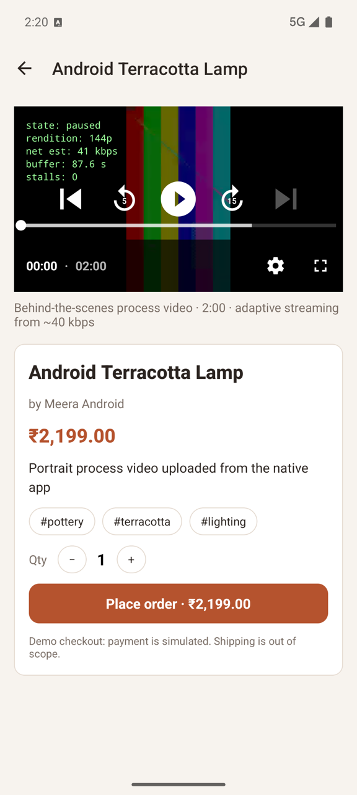
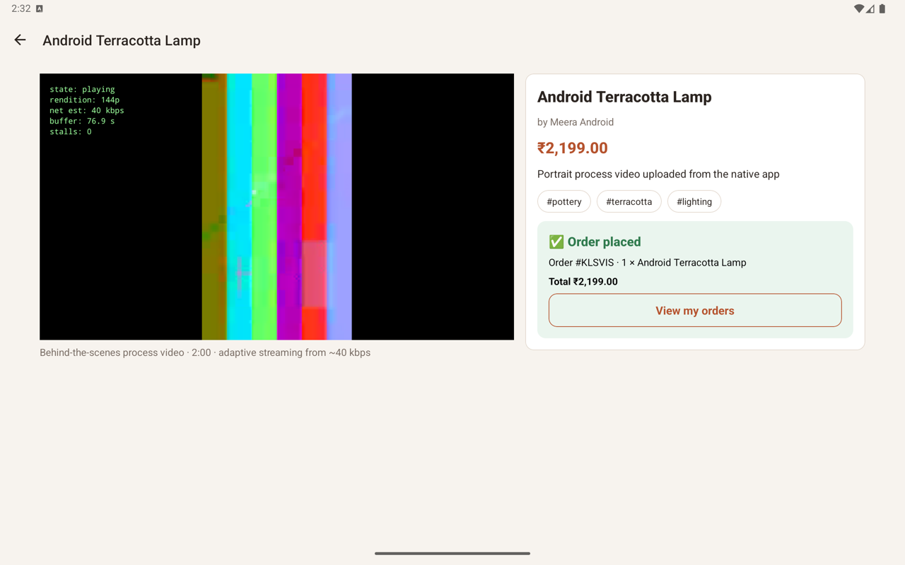
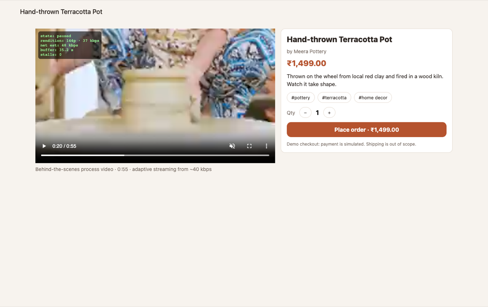
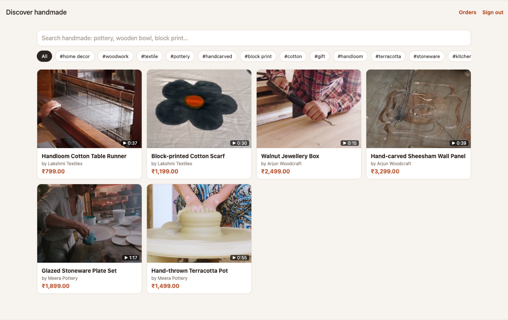

# Artisan Video-Commerce (microservices)

Artisans upload a behind-the-scenes process video (up to 15 minutes, any file size) for a hand-made
product. Buyers search the catalogue by keyword or tag, watch the video and place an order. The flow
ends at order placement; shipping and fulfilment are out of scope.

One Expo codebase runs as a native Android app (phone and tablet) and as a web app in Chrome. The
backend runs entirely on Google Cloud.

This is the microservices version of the backend. It keeps the same public API, so the Android and
web apps are unchanged. It has been run and tested locally only and is **not deployed**: the live
demo at https://artisan-api-398082391608.asia-south1.run.app still runs the monolith.
See [docs/MICROSERVICES.md](docs/MICROSERVICES.md) for the design and what was verified.

## Architecture

| Part            | Technology                                                                         | Runs on                           |
| --------------- | ---------------------------------------------------------------------------------- | --------------------------------- |
| App             | Expo SDK 57, Expo Router, TypeScript. ExoPlayer (Media3) on Android, hls.js on web | Android APK, web build in gateway |
| gateway         | Node 22, Express 5, streaming reverse proxy                                        | Cloud Run (public)                |
| auth-service    | Demo sign-in, JWT                                                                  | Cloud Run (internal)              |
| catalog-service | Products, uploads, search, transcoder trigger, video events                        | Cloud Run (internal)              |
| order-service   | Orders; reads products through catalog-service                                     | Cloud Run (internal)              |
| media-service   | HLS streaming from Cloud Storage                                                   | Cloud Run (internal)              |
| Transcoder      | Node + ffmpeg (H.264, Opus, HLS with fMP4 segments), publishes to Pub/Sub          | Cloud Run Job                     |
| Data and events | Firestore (users, products, orders), Pub/Sub topic `video-events`                  | GCP                               |
| Media           | Cloud Storage: private raw bucket, private HLS bucket                              | GCP                               |

Uploads go straight from the client to Cloud Storage through a resumable upload session, so file size
is not limited by any service. When the upload finishes, catalog-service starts the transcoder job.
The job writes an adaptive HLS ladder to the media bucket and publishes `video.ready` (or
`video.failed`) to Pub/Sub; catalog-service receives it through a push subscription and updates the
product. Players fetch playlists and segments through the gateway and media-service, because our GCP
organisation does not allow public buckets. See [docs/MICROSERVICES.md](docs/MICROSERVICES.md).

## Playback under 50 kbps

Every video is transcoded into four renditions with closed 4-second GOPs, so players can switch at any
segment boundary:

| Rung | Video                                    | Audio             |
| ---- | ---------------------------------------- | ----------------- |
| 144p | H.264 baseline, 12 fps, 22 kbps (max 26) | Opus mono 12 kbps |
| 240p | 15 fps, 110 kbps                         | Opus mono 24 kbps |
| 360p | 24 fps, 350 kbps                         | Opus 32 kbps      |
| 720p | 24 fps, 1400 kbps                        | Opus 64 kbps      |

Both players start on the lowest rung and only move up after measuring more bandwidth. hls.js uses
`startLevel: 0` with a 40 kbps initial estimate. ExoPlayer gets a 40 kbps `initialBitrate`; we give
each player a fresh bandwidth meter, because react-native-video otherwise reuses an estimate from an
earlier, faster connection and starts on 720p. A 5-15 KB poster image is shown before any video loads.
An overlay on the player shows the current rendition, bandwidth estimate, buffer and stall count.

### Measured results

Bitrate of the 144p rung, from the segment files in Cloud Storage. The test clips are ffmpeg test
patterns with heavy grain, which are harder to compress than camera footage; the demo products use
stock footage from Pexels.

| Video                                                   | Length    | Average        | Largest 4-s segment |
| ------------------------------------------------------- | --------- | -------------- | ------------------- |
| Test clip                                               | 0:30      | 36.1 kbps      | 38.4 kbps           |
| Test clip, portrait                                     | 2:00      | 35.5 kbps      | 40.6 kbps           |
| Test clip                                               | 14:55     | 36.6 kbps      | 39.5 kbps           |
| Pottery wheel, with audio                               | 0:55      | 26.3 kbps      | 35.0 kbps           |
| Wood carving, with audio                                | 0:39      | 35.9 kbps      | 44.0 kbps           |
| Chiselling, glazing, block printing, weaving (no audio) | 0:15-1:17 | 22.7-23.5 kbps | 23.6-29.0 kbps      |

`node backend/worker/scripts/test-ladder.js <video>` measures the same thing locally.

Playback tests at 40 kbps:

- Chrome (DevTools network throttling at 40 kbps, 300 ms latency): the 55-second pottery video and a
  2-minute test clip both played start to end on 144p with 0 stalls. On the pottery video the buffer
  grew to 13.7 seconds while playing; on the test clip media downloaded at 33.9 kbps.
- Android emulator, routed through `tools/throttle-proxy.mjs` at 40 kbps: play pressed 7 seconds after
  opening the product, 144p throughout, 0 stalls to the end of a 2-minute video, with the proxy
  measuring 37.7-39.4 kbps on the link.

These tests used ffmpeg test-pattern videos and Android emulators (Pixel 8, Pixel Tablet). They
have not been repeated on a physical device.

## Running locally

With Docker:

```bash
npm run dev          # docker compose up --build; open http://localhost:8080
```

Without Docker (needs Node 22, ffmpeg, Java 21 and the gcloud components `cloud-firestore-emulator`
and `pubsub-emulator`):

```bash
cd backend && npm install && cd ..
npm run dev:native   # emulators + all services as Node processes; logs in .local-logs/
```

Both use the Firestore and Pub/Sub emulators and keep video files in `.local-storage/`. Set
`STORAGE_MODE=gcs` with `RAW_BUCKET` and `MEDIA_BUCKET` to use Cloud Storage instead.

```bash
# App on web against the local gateway
cd app && npm install && npx expo start --web

# App on Android
EXPO_PUBLIC_API_URL=http://10.0.2.2:8080 npx expo run:android
```

Check the ladder on any video: `cd backend/worker && node scripts/test-ladder.js <video>`.

Seed six demo products: `node backend/scripts/seed.js <gateway-url> [folder-of-videos]`.

## Deploying

```bash
PROJECT_ID=<project> REGION=asia-south1 ./infra/deploy-microservices.sh
```

**This script has not been run.** It enables the APIs, creates Firestore, the buckets, an Artifact
Registry repository, the JWT secret in Secret Manager, one service account per service with
least-privilege IAM, the `video-events` topic and its authenticated push subscription, builds the
images with Cloud Build, and deploys the five services and the transcoder job. Only the gateway is
public; the other services require the Cloud Run invoker role.

## API

| Method | Path                         | Role    | Purpose                                         |
| ------ | ---------------------------- | ------- | ----------------------------------------------- |
| POST   | `/api/auth/demo`             | -       | `{ name, role }` returns a JWT                  |
| POST   | `/api/products`              | ARTISAN | Create a product and get a resumable upload URL |
| POST   | `/api/products/:id/complete` | ARTISAN | Upload finished, start transcoding              |
| GET    | `/api/products/mine`         | ARTISAN | The artisan's products with status              |
| GET    | `/api/products?q=&tag=`      | -       | Search ready products                           |
| GET    | `/api/products/tags`         | -       | Tags for the filter chips                       |
| GET    | `/api/products/:id`          | -       | Product details and HLS URL                     |
| POST   | `/api/orders`                | BUYER   | Place an order                                  |
| GET    | `/api/orders/mine`           | BUYER   | The buyer's orders                              |
| GET    | `/media/videos/:id/...`      | -       | HLS playlists, segments and poster              |

## Repository layout

```
app/                        Expo app: src/app (screens), src/components, src/lib
backend/shared/             Shared package: config, JWT, logging, errors, storage, service calls
backend/services/gateway/   Public entry point; serves the web build from public/
backend/services/*-service/ auth, catalog, order and media services
backend/worker/             Transcoder job; src/ladder.js holds the bitrate ladder
backend/scripts/            Seed script, Pub/Sub emulator setup
infra/                      deploy-microservices.sh (not run), cloudbuild.yaml, bucket CORS
scripts/dev-native.sh       Local stack without Docker
docker-compose.yml          Local stack with Docker
tools/                      Bandwidth-limiting proxy used for the Android playback test
docs/                       Architecture, microservices design, demo guide, screenshots
```

## Known limitations

- Sign-in is a demo: a name and role, no password. Production would use Firebase Auth.
- Payment is simulated. Shipping, logistics and tracking are out of scope by design.
- This version has not been deployed; see docs/MICROSERVICES.md for what was verified locally.
- Search uses Firestore token arrays, which is fine for a small catalogue but not for a large one.
- Video is streamed through Cloud Run without a CDN. A CDN in front of `/media` would cut latency and
  cost; the cache headers are already set for it.
- The 15-minute limit is checked in the app when a file is picked and again by the transcoder.
  A longer file is only rejected after upload if the app check is bypassed.
- The release APK is signed with the debug key.
- Demo product videos are stock footage from Pexels (Pexels License), not footage from real artisans.

## Screenshots

| Android phone, 40 kbps                          | Android tablet                                     | Chrome, 40 kbps                               |
| ----------------------------------------------- | -------------------------------------------------- | --------------------------------------------- |
|  |  |  |


